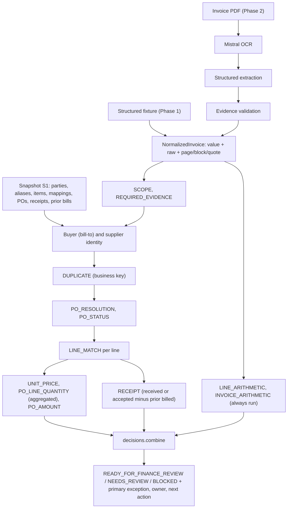

# Build status

Last updated: 2026-11-14. **Checkpoint: Phase 2 complete and verified live. Paused for review before Phase 3.**

## Last verified checkpoint

| Phase | State | What actually ran |
|---|---|---|
| 0. Repo and acceptance contract | Done | `uv sync` on Python 3.12.15; all dependencies import; `MISTRAL_API_KEY` presence checked (absent, not needed until Phase 2). Git initialized; local commit `f5d4a3b`. |
| 1. One decision locally, structured input | Done | `uv run python -m scripts.run_structured H1` returns READY_FOR_FINANCE_REVIEW with 600 EA order remaining, 200 EA received and unbilled, ₹1,41,600.00 gross remaining. `uv run pytest`: 23 passed. |
| 2. H1 from a real PDF through the app | **Done, verified live** | Fresh browser upload of H1_digital in the app on 2026-11-14 reached READY_FOR_FINANCE_REVIEW with real OpenRouter calls (OCR 2.7 s, extraction 4.6 s); History entry saved; page refresh reopened the persisted run without resubmitting. `scripts.live_eval` on digital, scan and two-page: all READY, 23/23 critical fields agree with the known H1 values. `uv run pytest`: 53 passed. |
| 3. Four exception workflows | Not started | Domain functions for PO candidates (E2), duplicate (E1), party/item resolution (E3) and receipt shortfall (E4) exist and some are unit-tested on structured input only. No review actions, revisions or S2 yet. |
| 4. Reviewer workflow and reliability | Not started | — |
| 5. Release and demo | Not started | — |

Status vocabulary: **planned** = designed only; **tested locally** = pytest/CLI on structured or local input; **verified live** = real PDF through real provider calls in the app. Phase 2 is verified live (see Live results).

## Reproduce

```bash
uv sync
uv run python -m scripts.validate_snapshot S1     # seed validation + balances
uv run python -m scripts.run_structured H1        # structured-input domain check
uv run python -m scripts.run_structured H1 --json var/exports/H1.json
uv run pytest
uv run python -m scripts.make_fixtures             # regenerate H1 PDFs (deterministic)
uv run python -m scripts.smoke_openrouter          # needs OPENROUTER_API_KEY in .env
uv run streamlit run app.py                        # http://localhost:8501
```

Observed on 2026-11-11: 50 tests passed (23 domain + 23 workflow/parsing + 4 UI). Workflow tests use a fake provider and prove plumbing only: stage order, persistence, reopen after restart, exact-byte reuse without model calls, re-rendered duplicate blocked as an attempt, idempotent submission token, corrupt PDF rejected before model calls, provider timeout/auth -> FAILED with no recommendation, OCR reuse on retry, interrupted-run recovery, call cap, unsupported value -> unknown -> review, document warning -> review.

Observed on 2026-11-10: snapshot S1 OK; H1 READY_FOR_FINANCE_REVIEW with all 14 checks PASS; 23 tests passed. A mutation check (receipt balance ignoring prior billing) made 4 tests fail, including the targeted boundary test, then the code was restored.

## Live results (2026-11-14, OpenRouter, synthetic PDFs)

Smoke (`scripts.smoke_openrouter`, H1_digital): OCR 2.0–2.1 s, 1 call, cost reported $0.0021 (mostly the $2/1,000-page OCR fee); extraction 4.1–5.4 s, ~2,000 tokens, ~$0.0007. Both served by provider Mistral.

| File | Decision | Critical fields agreeing | Wall time | Provider calls | Evidence |
|---|---|---|---|---|---|
| H1_digital (app upload) | READY | — (inspected in Review) | 7.3 s in stages | 2 | all values found in OCR |
| H1_digital (`live_eval`) | READY | 23/23 | 4.5 s | 1 (OCR reused for identical file hash, labelled in provenance) | 0 re-anchored, 0 unsupported |
| H1_scan | READY | 23/23 | 10.8 s | 2 | 0 re-anchored, 0 unsupported |
| H1_two_page | READY | 23/23 | 10.6 s | 3 (2 OCR pages + extraction) | 0 re-anchored, 0 unsupported |

Each `live_eval` file ran once in its own fresh workspace. The three-repeat live matrix (SPEC.md §17) is a Phase 4 release gate and has not run.

Issues found by the first live calls and fixed (with regression tests):
- OCR annotation text is wrapped in `<file name="..."> ... </file>`; those lines are no longer blocks.
- The model reported the "SYNTHETIC DEMO DOCUMENT" banner as a warning, which would have routed every invoice to review. Warnings are now a closed set of kinds (CONFLICTING_VALUES, MULTIPLE_PO_REFERENCES, MULTIPLE_INVOICES, EMBEDDED_INSTRUCTIONS).
- The model copied invoice-level tax/total into the line's tax/gross fields. Line tax/gross citing a block outside the line's own row are now dropped to unknown; the prompt says so too.

Known UI nits (Phase 4): status metrics truncate ("Match…") at narrow widths; "Finance — Finance reviews…" repeats the owner; sidebar call counter is drawn before a run finishes.

## Input-to-decision flow



## Phase gates

- **Phase 2:** fresh H1 PDF upload reaches READY with real Mistral calls; history entry saved; refresh reopens the persisted run; scan and two-page variants tested with field agreement recorded. Requires `MISTRAL_API_KEY` in local `.env`.
- **Phase 3:** E1–E4 each have a PDF, a regression test and a manual reproduction; E2/E3/E4 recover via recorded revisions; H1 still passes.
- **Phase 4:** three screens complete; invalidation, stale-revision, duplicate, restart and failure-state tests; live evaluation matrix recorded.
- **Phase 5:** clean install, Docker build, hosted fresh-browser run, persistence after restart (needs user's hosting account).

## Code map (Phase 1)

| File | Responsibility |
|---|---|
| `src/domain/snapshot.py` | Typed snapshot records, `validate_snapshot` with row-level errors, read-only lookups. |
| `src/domain/invoice.py` | `NormalizedInvoice`; every scalar is `Evidenced[T]` (raw, value, evidence). |
| `src/domain/matching.py` | `resolve_party`, `identify_item`, `resolve_lines`, `candidate_pos`, `resolve_po`. |
| `src/domain/duplicates.py` | Business-key duplicate classification. |
| `src/domain/rules.py` | Independent checks and `build_po_context` (aggregated per-PO-line balances). |
| `src/domain/decisions.py` | `combine`: mandatory check coverage and recommendation precedence. |
| `src/domain/pipeline.py` | `evaluate`: dependency order and NOT_RUN propagation. Pure; caller supplies time. |
| `src/services/loaders.py` | File I/O for policy, seeds and fixtures. |
| `scripts/run_structured.py`, `scripts/validate_snapshot.py` | CLI entry points. |
| `tests/` | Seed facts, H1 readiness, fail-closed boundaries. |

## Decisions and assumptions

1. **Synthetic registration IDs** use the form `SYN-REG-...` so they cannot be mistaken for real tax registrations.
2. **`prior_invoices` header collection added** alongside `prior_invoice_lines` (v2 lists only lines). Headers carry bill identity, state (POSTED/DRAFT) and payment status for duplicate checks and "unpaid is still billed". DRAFT bills are shown as pending exposure, not counted as billed.
3. **Receipts for PO-101 split into two GRNs** (350 + 250 = 600 EA) to exercise "partial receipts across shipments" while keeping v2 totals exact.
4. **PO line carries `tax_rate_pct`** so the importer can verify the header gross cap against its lines (1000 × 200 × 1.18 = 236,000).
5. **Charges or discounts that are non-zero** go to review (unsupported in demo). Missing charges/discount are treated as absent; **missing tax is never zero** (TAX_MISSING).
6. **Capacity checks wait for all lines.** If any invoice line is unmatched, PO_LINE_QUANTITY, PO_AMOUNT and RECEIPT are NOT_RUN, so a partial set cannot understate the bill.
7. **PO_PARTY_CONFLICT is REVIEW** (owner procurement), not BLOCK: the supplier may reissue. A CLOSED/CANCELLED PO or non-ACTIVE supplier is BLOCK.
8. **Party with matching registration ID but an unapproved name** is AMBIGUOUS/PARTY_NAME_UNVERIFIED (needs review), per v2 table row 1 requiring an approved variation.
9. **Similarity suggestions** use RapidFuzz with a display cutoff of 50/100; they never select.
10. **`mistralai` resolved to 3.7.0.** The OCR and structured-output call shapes must be confirmed against this SDK version at the Phase 2 gate.

11. **Model access through OpenRouter** (user decision 2026-11-11) instead of a direct Mistral key. Extraction: `mistralai/mistral-small-2603` with `response_format: json_schema` (strict) and `provider.require_parameters: true`. OCR: OpenRouter `file-parser` plugin, engine `mistral-ocr`; OpenRouter chooses the Mistral OCR version, so `mistral-ocr-4-1` cannot be pinned. Recorded as a deviation from SPEC.md §11. `mistralai` dependency removed; `httpx` added.
12. **One OCR call per page.** OpenRouter returns OCR text as a single annotation per file without page numbers. The PDF is split locally (pypdf) so each page's text carries an exact page number. Blocks are OCR lines, IDs `p{page}-b{n}`. Same per-page price; more calls (pages + 1 per run).
13. **The model copies printed text and cites a block; Python parses numbers and dates.** Evidence check: cited block must contain the text; if found in another block it is re-anchored with a note; if absent from the OCR the value becomes unknown (fail closed). Ambiguous numeric dates (e.g. 01/02/2026) stay unknown.
14. **Extraction warnings route to review** via a DOCUMENT_WARNINGS check (conflicting values, several POs, embedded instructions). Evidence housekeeping notes are informational only.
15. **Cases vs attempts.** A case (unique bill) is created only when buyer, supplier and invoice number resolve and the bill is new. A re-rendered copy of a workbench bill or a snapshot-ledger bill is a DUPLICATE_ATTEMPT with no new case. Identical bytes create an EXACT_REPEAT run reusing the earlier result with no model calls.
16. **Workspace in the URL** (`?ws=`, `?run=`), so refresh reopens the persisted run; "Start a fresh workspace" gives an independent duplicate scope (needed to run the H1 scan and two-page variants without them being blocked as duplicates of H1).

## Open blockers and inputs

- None blocking. `OPENROUTER_API_KEY` is set in local `.env` (git-ignored).
- Port 8501 is used by another local project; the preview config runs this app on 8510. `uv run streamlit run app.py` alone still defaults to 8501.
- Confirmed live: `file` content part with `file.filename` / `file.file_data` works; OCR text is markdown with pipe tables.
- Phase 0–1 committed locally as `f5d4a3b` on `main`. Phase 2 not yet committed. No remote; nothing pushed.

## Next task

Phase 3, one exception at a time from S1 in independent workspaces: E1 duplicate (AP-099 re-rendered), E2 missing PO (AP-205, confirm PO-102 with PROC-CONF-205), E3 unfamiliar supplier/item (AP-206, MASTER-VERIFY-206), E4 receipt shortfall (AP-207, then explicit S2). Needs: E1–E4 PDFs, review actions with immutable revisions and recheck, snapshot S2 and a "Load next demo snapshot" action.
