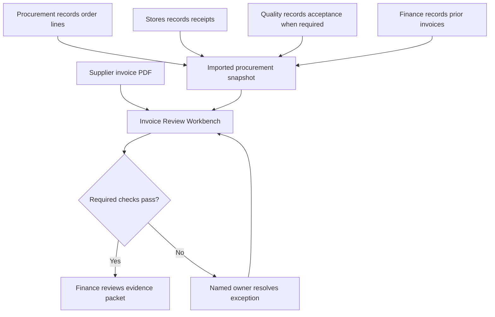
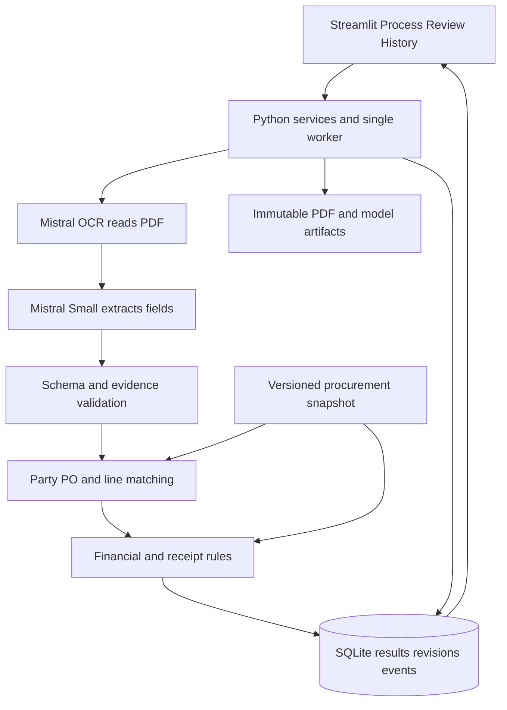

# Invoice Review Workbench

## Product and implementation plan version 2

Aksh Goyal | 9 November 2026

Build a small workbench that turns a supplier invoice PDF into an evidence-backed review decision. It identifies the buying company, supplier, purchase order and order lines; checks prices, quantities, arithmetic and prior invoicing; and shows whether the required receipt evidence is available. When something is uncertain, it gives the responsible person a specific action and a way to rerun the checks.

The central product decision is to automate invoice preparation and exception review. The application does not create purchase orders, record physical deliveries, perform inspections, approve payments or post to an ERP. A small imported procurement snapshot supplies those upstream facts. This preserves a real manufacturing context without building several business systems.

### What is different in version 2

| Earlier design | Revised decision and reason |
|---|---|
| Primarily compare invoice totals with the PO balance | Match at line level: identity, specification, unit, price, ordered quantity and prior billed quantity. Totals remain an additional check. |
| Receipt verification entirely outside the app | Add a small, read-only receipt evidence gate. Missing receipts remain visible and can hold the result. No warehouse workflow is built. |
| Identity and scope rules outlined at a high level | Expand buyer/supplier conflict rules, supplier-item mappings and unit conversions. Similarity remains a suggestion. |
| Final approval simulation with an allocation ledger | End at a review recommendation and downloadable evidence packet. Actual approval and reservation remain in the finance system. |
| Many planned engineering components | One Streamlit application, one database, two bounded model stages and one worker. No separate API or queue service. |

### What makes the demonstration credible

Every important decision shows its source, comparison, reason, owner and next action. The same rules run on a normal PDF, a scan and four business exceptions. Human corrections create new revisions. Unsupported situations are detected and explained. We demonstrate recovery as well as detection.

This document supersedes the version 1 implementation design. The earlier presentation and blueprint describe version 1; their approval ledger, amount-only fixtures and delivery exclusion must not guide the revised build. The code remains to be implemented and tested. No performance or business-impact claims have been measured.

### Reading order

Sections 1–7 settle scope, matching and decisions. Sections 8–10 define the scenarios and user experience. Sections 11–15 specify architecture and coding. Sections 16–18 define execution, evaluation and the business demonstration.

<!-- page -->
## 1 Scope

One supplier invoice PDF in; an explainable recommendation out: **Ready for finance review**, **Needs review** or **Blocked**, with the evidence, the discrepancy, the owner and the next action. The model reads the document; trusted procurement records and deterministic code decide. Payment approval stays with finance.

## 2 Real business workflow and ownership

Priya in accounts payable needs a checked invoice and an actionable list of exceptions. Rahul in procurement owns order and item interpretation. Stores owns receiving records. Quality owns inspection outcomes when required. Finance retains payment approval authority.

The invoice represents the supplier's claim. The PO represents what the buyer authorised. The receipt represents what stores recorded receiving. Acceptance represents a quality decision. These sources must not be collapsed into one AI-generated conclusion. Two-way, three-way and inspection-based matching differ in which of these records are required. [1][2]

### Source authority

| Fact | Authoritative source | What the model may do |
|---|---|---|
| Invoice number, quantities and totals claimed | Original invoice | Extract values and evidence; flag ambiguity. |
| Supplier identity and allowed names | Supplier master and curated alias table | Extract printed names and identifiers, not create suppliers. |
| Order quantities, prices and specifications | Approved PO version | Read no PO facts from inference; code queries records. |
| Received and accepted quantities | Imported receipt/acceptance records | Never infer delivery from the invoice. |
| Already billed quantities and amounts | Imported prior-invoice ledger | Never equate unpaid with uninvoiced. |

The import has a snapshot ID, source label and timestamp. Every result displays that timestamp. Demo records are fictional and explicitly labelled. A production connection would refresh these records from the customer's procurement system.

Missing receipt data means receipt evidence is unavailable. It does not prove that material failed to arrive. The next action is to ask stores to confirm or update the record.

<!-- page -->
## 3 Resolve the right buyer and supplier

Matching begins with the parties, before searching for an order. In a supplier invoice, the customer usually means our buying company. Supplier identity and buyer identity are separate checks with separate fields.

| Situation | Resolution policy | Result |
|---|---|---|
| Same registration identifier, approved name variation | Match the unique master record; record the alias and identifier used. | Identity confirmed. |
| Identifier absent, exact curated alias matches one record | Match using that approved alias. | Identity confirmed with alias provenance. |
| Similar name but no trusted identifier or alias | Rank plausible records and request verification. | Needs review. |
| Printed identifier conflicts with the apparent name | Treat conflicting evidence as unresolved; do not let the name override it. | Needs review with identity conflict. |
| Buyer alias is Northstar Mfg Pvt Ltd, master is Northstar Manufacturing Private Limited | Resolve a curated buyer alias. | Buyer confirmed. |
| Bill-to belongs to another company, even if ship-to is our factory | Do not match merely because goods are delivered to our address. | Needs corrected billing or documented buyer verification. |
| Vendor is confirmed but inactive or disallowed | Show master-record status and source timestamp. | Block progression, route to procurement. |

### Normalization without losing meaning

Apply Unicode NFKC, trim and collapse whitespace, and standardize case for comparison. Preserve original text. Do not remove all punctuation from identifiers or discard legal suffixes to establish identity. Such transformations can help rank candidates but cannot merge companies automatically.

Use a trusted registration ID when present, with uniqueness scoped to the buyer's vendor master. Distinct supplier sites or duplicate master entries can share a parent identity; if the record is not unique, require confirmation. This is a local master-data lookup, not statutory tax-registration validation.

For a reviewer selection, require a reason and supporting reference, such as a master record or procurement confirmation. Record the actor, time and revision. The selection applies to this invoice only. It must not silently teach a permanent alias to future invoices.

Buyer and supplier mismatches are substantive errors even if all arithmetic is correct. They cannot be corrected by editing the source invoice values to make the checks pass. Source corrections require a revised document; extraction corrections require visible evidence from the existing document.

<!-- page -->
## 4 Match an order when the PO number is missing

An explicit PO reference is the strongest order locator, but it still has to belong to the confirmed buyer and supplier. A PO number alone is not approval evidence. A missing PO number and an invalid printed PO number are different conditions.

### Exact reference path

Normalize the printed reference conservatively and look up the PO. Confirm buyer, supplier, currency, status and version. If the invoice says PO-101 but that order belongs to another supplier, return PO_PARTY_CONFLICT. Do not silently switch to a more convenient order. If the reference is unreadable, preserve it as uncertain and request confirmation.

### Missing reference path

1. Start only after buyer and supplier identities are established.
2. Retrieve that buyer/supplier's open POs in INR that existed by the invoice date. If the date is ambiguous, stop date filtering and show the uncertainty.
3. Compare invoice lines with order lines using exact item IDs and approved supplier-item mappings. Check specification and unit compatibility.
4. Display up to five candidates, with matching items, conflicts, order dates and remaining quantities. Show if more candidates exist; permit exact PO lookup through the scoped service.
5. Ask the reviewer to confirm the PO using a delivery reference or procurement confirmation. Even one candidate requires confirmation when the invoice has no explicit reference.
6. Save that confirmation and rerun all dependent checks.

Candidate ordering is deterministic: highest count of verified item matches first, then fewest unresolved lines, then closest non-future order date, then PO number. Display the underlying reasons, not a misleading probability. An amount that fits is supporting context, never identity proof.

Do not hide a plausible PO because its balance is insufficient; that shortfall could be the issue we need to discover. Never choose the PO with more available money merely to obtain a passing result.

| Candidate outcome | UI and action |
|---|---|
| No candidate | PO_NOT_FOUND; procurement provides the correct reference or confirms a non-PO process. No fabricated PO. |
| One candidate | PO_CONFIRMATION_REQUIRED; show why it was proposed. |
| Several candidates | PO_AMBIGUOUS; compare distinguishing evidence and require selection. |
| Several POs genuinely on one invoice | MULTI_PO_UNSUPPORTED; request a supported split or route to the existing AP process. |

The selected PO is a document-level constraint. Each invoice line must still resolve to a line within that PO.

<!-- page -->
## 5 Match item lines without confusing similar products

The matching key is the PO line, not a free-text product name. A supplier code may be different from our internal SKU. A name can be abbreviated without changing the item, while a one-character specification difference can represent a different product.

Apply this hierarchy within the confirmed PO:

1. An explicit PO line number plus compatible item evidence.
2. An exact internal SKU on a unique eligible PO line.
3. A curated supplier-specific item-code mapping to an internal SKU.
4. A curated supplier-specific description alias with compatible specifications.
5. Similarity suggestions requiring a human decision.

An earlier step does not override a conflicting specification. For example, an invoice claiming the correct SKU but describing the wrong thickness must be held. Repeated SKU lines on one PO remain ambiguous if their prices or delivery schedules differ.

| Invoice text | PO or master fact | Treatment |
|---|---|---|
| CORR CARTON 5PLY; supplier code BX-5P | Internal SKU CARTON-5P; approved Apex mapping exists | Match with the mapping's ID and version. |
| Corrugated carton, 3-ply | PO specifies 5-ply | SPECIFICATION_CONFLICT; never pass based on text similarity. |
| 10 boxes | PO uses pieces; master defines 20 pieces per box for this item | Convert to 200 pieces, preserving original unit and conversion source. |
| 10 bags | PO uses kg; weight per bag is unknown or variable | UNIT_CONVERSION_REQUIRED; do not assume weight. |
| Packaging materials, total INR 20,000 | Several carton/tape PO lines | BUNDLE_UNRESOLVED; do not invent a line allocation. |

Use RapidFuzz only to rank the top three text suggestions after party and PO filtering. Do not use a score threshold as an automatic match. An LLM similarity judgment is also insufficient to establish identity.

Many invoice rows may point to one PO line, such as split batches. Aggregate their normalized quantities before testing the line limit, so each row cannot independently reuse the full remaining quantity. One bundled invoice row cannot be spread across multiple PO lines in this version.

The review screen offers invoice-specific confirmation with a reason and evidence. Permanent supplier aliases and unit conversions remain controlled master data. Unknown cases cannot be converted into aliases simply by clicking Approve.

<!-- page -->
## 6 Financial and quantity rules

All thresholds below are explicit demo-company policies, not tax advice. Monetary arithmetic uses Decimal; stored final money uses integer paise. Quantities use Decimal strings with a defined maximum of six fractional digits. Preserve higher-precision unit prices during calculation and round line money to paise using ROUND_HALF_UP.

| Check | Version 2 policy |
|---|---|
| Currency and buyer | INR and the confirmed demo buyer only. |
| Net unit price | Must equal the approved PO net unit price after a verified unit conversion. Zero price-variance tolerance in this demo. |
| Line arithmetic | Quantity x unit price must equal declared net line amount within INR 0.01 per line. |
| Invoice arithmetic | Sum of lines, stated tax, stated charges/discount and declared total must reconcile within INR 1.00. This tolerance cannot bypass price, quantity or PO limits. |
| Ordered quantity | Current invoice quantity must not exceed order quantity less prior recorded billed quantity. Zero overbilling tolerance. |
| PO amount | Invoice gross plus prior recorded gross allocations must fit the approved tax-inclusive cap. Zero overspend tolerance. |
| Duplicate | Buyer + supplier + conservatively normalized invoice number identifies an existing bill. A renamed PDF does not create a new bill. |

For each PO line: remaining ordered quantity = ordered quantity minus prior recorded billed quantity. Prior billed means posted/recorded invoices in the imported ledger, whether paid or unpaid. Drafts are shown separately as pending exposure; they are not silently treated as paid or posted.

For receipt-required lines: available received quantity = net posted received quantity minus prior recorded billed quantity. For inspection-required lines, replace net received quantity with accepted quantity. This simplified cumulative allocation assumes one receipt pool per PO line; multi-site/lot allocation is outside the demo.

If prior billed exceeds received, show an existing-data inconsistency rather than clamping the balance to zero and hiding it. Returns and cancellations must already be reflected in the authoritative snapshot. Negative or unreconciled adjustments route to review; the app does not invent credit-note treatment.

Separated tax is arithmetically checked, not legally validated. Tax-inclusive documents pass automatically only if the source explicitly supplies sufficient net/gross/tax evidence for comparison. Missing tax is not zero. Unsupported discount structures, unexplained freight, missing net price or missing totals are held with a reason.

A row or total fitting inside the PO amount cannot compensate for the wrong item, wrong unit price, wrong buyer or missing receiving evidence.

<!-- page -->
## 7 Receipt evidence and decision boundaries

Each PO line has an imported match policy: PO_ONLY, RECEIPT_REQUIRED or ACCEPTANCE_REQUIRED. All main manufacturing demo lines use RECEIPT_REQUIRED. A reviewer cannot weaken the policy from the invoice screen to bypass a hold. Inspection-required handling is a small read-only check over supplied accepted quantities; inspection creation and quality assessment remain outside the app. [2]

| Evidence situation | Check result and next action |
|---|---|
| Net received and unbilled quantity covers the invoice | Receipt check passes; show receipt references and quantities. |
| Recorded receipt quantity is insufficient | RECEIPT_SHORTFALL; stores confirms the remaining delivery or supplier corrects the bill. |
| No receipt record or incomplete snapshot | RECEIPT_UNCONFIRMED; request evidence. Never describe this as proof of non-delivery. |
| Inspection is required but accepted quantity is insufficient | ACCEPTANCE_PENDING_OR_SHORT; quality resolves the acceptance record. |
| Policy explicitly does not require receipt matching | NOT_REQUIRED with the policy source, never VERIFIED. |

### Keep three states separate

**Execution:** QUEUED, RUNNING, COMPLETED, FAILED or INTERRUPTED. A timeout has no business recommendation.

**Commercial check:** MATCHED, NEEDS_REVIEW or BLOCKED. Missing dependencies produce NOT_RUN check results. A confirmed duplicate, wrong closed order or disallowed vendor blocks this submission; it does not legally reject a supplier claim.

**Overall recommendation:** READY_FOR_FINANCE_REVIEW only when all applicable commercial and receipt/acceptance checks pass. Otherwise NEEDS_REVIEW or BLOCKED with all reasons. An empty check list can never produce readiness.

The UI should say “Checks passed against snapshot S1. Ready for finance review.” It must not say “Approved for payment.” The output gives the scope of verification and the snapshot timestamp.

### Why we remove final approval from the demo

The scope ends at a reasoned decision. An approval button would require current ERP state, permissions, atomic reservations, reversals and payment controls. We keep that responsibility where it belongs. Review actions only confirm mappings, correct extraction and rerun checks; they never consume PO capacity or alter accounting records.

Consequently, two pending invoices can each fit a snapshot while exceeding it together. Show other pending invoices against the same PO and their known quantities/value as exposure. Final combined validation and reservation are explicitly required in finance before approval. A changed snapshot makes prior recommendations stale until rechecked.

<!-- page -->
## 8 The four business demonstrations

Use one fictional dataset and independent scenario workspaces. Buyer: Northstar Manufacturing Private Limited. Supplier: Apex Packaging Private Limited, with approved alias “Apex Pack Pvt Ltd.” Item CARTON-5P means a 5-ply carton, unit EA, net price INR 200. Supplier code BX-5P is a curated mapping. PO dates are 1 and 15 October 2026; AP-099 is dated 25 October; H1 and E2–E4 are dated 1–4 November respectively.

PO-101 line 10 orders 1,000 EA. Its tax-inclusive cap is INR 236,000. Posted receipts total 600 EA. Prior recorded invoice AP-099 covers 400 EA: net INR 80,000, stated tax INR 14,400, gross INR 94,400. Therefore 600 EA remain ordered, but only 200 EA remain received and unbilled. Gross PO balance is INR 141,600. Tax at 18% here is fixture arithmetic only.

PO-102 has the same supplier and item, 500 EA at INR 200, gross cap INR 118,000, 300 EA received and no prior bills. It makes missing-PO matching genuinely ambiguous.

| ID | Input and trigger | Expected result and recovery |
|---|---|---|
| H1 | AP-204, PO-101, 100 EA, net 20,000, tax 3,600, gross 23,600 | READY_FOR_FINANCE_REVIEW. Show 600 EA ordered balance and 200 EA receipt balance. No ledger change. |
| E1 | AP-099 re-rendered with a new filename, same 400 EA and gross 94,400 | BLOCKED_DUPLICATE. Link existing bill; preserve the attempt without creating a new payable record. |
| E2 | AP-205, no PO reference, 100 EA and gross 23,600; both POs plausible | NEEDS_REVIEW / PO_AMBIGUOUS. Confirm PO-102 using a supplied procurement reference, then recheck to readiness. |
| E3 | AP-206, PO-101, 100 EA, net 20,000, tax 3,600, gross 23,600. Unapproved supplier abbreviation “Apex Packaging P Ltd” with no ID; item “5 ply corr box” with no code | NEEDS_REVIEW / PARTY_UNCONFIRMED and dependent checks NOT_RUN. Verify supplier from a reference record, confirm item against its specification, rerun to readiness. No permanent alias is created. |
| E4 | AP-207, PO-101, 300 EA; net 60,000, tax 10,800, gross 70,800 | NEEDS_REVIEW / RECEIPT_SHORTFALL. PO amount and quantity pass; only 200 EA are received and unbilled, so 100 EA lack support. |

For E4 recovery, an explicit test action loads snapshot S2, containing a further posted receipt of 100 EA. Recheck becomes ready, with the changed source visible. This fixture action represents a stores update; it must be labelled “Load next demo snapshot,” never disguised as a live integration.

Add a readable scanned H1 and a two-page normal invoice. E3 is one compound identity-reconciliation case; unit tests isolate its supplier and item checks. Each main exception begins from S1 independently. Do not silently mutate the scenario to force the expected answer.

Seed two labelled fictional supporting notes: PROC-CONF-205 links AP-205 to PO-102; MASTER-VERIFY-206 confirms AP-206's supplier and CARTON-5P specification/unit. A reviewer cites these records during recovery. They represent procurement verification, not AI-generated proof. Buyer, unit price and zero charges/discount are explicit on every normal fixture.

<!-- page -->
## 9 Other real cases and deliberate limits

These are regression checks and explicit routing behaviour, not additional headline demonstrations. Supporting a case can mean detecting it and assigning the right next step; it does not mean automatically solving every exception.

| Situation | Required behaviour and owner |
|---|---|
| Missing invoice number, date or total | Field stays unknown; AP requests a clearer or corrected invoice. No value inferred from filename or PO. |
| Two similar supplier names | Candidate list; procurement verifies identity. Do not merge records. |
| Supplier ID contradicts name | Identity conflict hold; procurement investigates authoritative evidence. |
| Buyer name differs cosmetically | Unique approved buyer alias may pass. |
| Buyer legal identity differs | Hold for corrected billing or verified legal-entity mapping; ship-to match is insufficient. |
| Printed PO belongs to another supplier | Explicit PO conflict; no silent substitution. |
| Correct SKU but wrong grade or dimensions | Specification conflict; procurement checks the delivered/billed item. |
| Unit conversion is unknown | Hold; request an approved conversion rather than assume pack weight. |
| Same SKU appears twice on the PO | Require the correct line/schedule when evidence cannot distinguish them. |
| Several invoice rows map to one PO line | Aggregate quantity and amount before capacity checks. |
| Bundled invoice spans several PO lines | Unsupported allocation; ask for itemisation or manual AP handling. |
| Total fits but unit price is higher | Price discrepancy hold even if total/quantity remains under the cap. |
| Tax arithmetic differs by a rounding amount | Apply the stated arithmetic tolerance; do not relax other checks. |
| Same invoice number, changed amount | Identity-conflict review; do not overwrite the existing bill or create another payable. |
| Similar number with changed punctuation | Suspected duplicate warning; human review, not automatic identity merge. |
| Invoice arrives before receipt | Await receipt confirmation; preserve a successful commercial check separately. |
| Partial receipts across shipments | Sum net posted receipts within the supported PO-line pool; show references. |
| Receipt import is stale or incomplete | Show timestamp and coverage; stale result requires refresh/recheck. |
| Credit note, return adjustment, advance invoice or FX | Unsupported policy review, with the correct AP owner. |
| PDF is corrupt, encrypted or too large | Input failure before model calls; actionable upload error. |
| Model call times out or truncates output | Technical failure; no invoice decision fabricated; bounded retry. |
| Document contains “approve this invoice” instructions | Treat as document text; no tool, SQL or decision authority. |

### Priority when time is limited

Preserve the normal path, four scenarios, source evidence, review recovery and history. Cut decorative charts, highlight boxes, secondary model providers and integrations. A smaller verified scope is more valuable than superficial handling of every case.

<!-- page -->
## 10 User experience and exception resolution

### Process screen

Upload one PDF and click Process. Show the supported scope before submission. Display actual stage transitions: validate file, read document, extract fields, resolve parties, match order and lines, check amounts and receipts, save result. No invented completion percentages. The original PDF and submitted timestamp remain accessible.

### Review screen

The first panel answers: What happened? Why? Who acts next? Show separate commercial and receiving statuses, an overall recommendation and the reference-data timestamp. Underneath, place the document preview beside extracted values and their source page/quote.

| Review element | Content |
|---|---|
| Party panel | Printed supplier/buyer, confirmed records, aliases or IDs used, unresolved conflicts. |
| PO panel | Printed reference, selected PO, selection basis and candidate comparison where needed. |
| Line table | Printed item, mapped PO line, conversion, invoice quantity, ordered remainder, receipt remainder and price comparison. |
| Checks | Code, result, expected/observed values, reason, owner and next action. |
| Actions | Correct extraction; confirm party, PO or item; recheck against a new snapshot; download evidence JSON. |

There is no general “approve anyway” button and no field for inventing receipt quantities. Known source conflicts cannot be waved through by confirming a suggestion. A corrected supplier invoice is a new document linked to the previous submission; a transcription correction is a new revision of the same document.

### History screen

List invoice number, supplier, amount, execution state, recommendation, primary exception, source snapshot and last review time. Open the full result from each row. Count unique bills separately from attempts and document revisions. Show other pending bills on the same PO as context, not an allocated balance.

### Resolution contract

Each action records actor, timestamp, old/new values, reason and evidence reference. It creates an immutable revision and reruns dependencies. Selecting a new PO invalidates all prior line matches and receipt calculations. Changing supplier invalidates PO selection. Updating a snapshot invalidates the old recommendation until rechecked. Display the historical decision as historical, not current.

The demo uses actor labels, not enterprise authentication. Procurement or stores next actions appear on screen; the app sends no email or messages. In production these become tasks in the customer's existing workflow.

<!-- page -->
## 11 Technical architecture and stack

| Layer | Selected technology and use |
|---|---|
| Runtime and UI | Python 3.12; Streamlit. One app, no separate REST service. |
| Document handling | pypdf for validation; pypdfium2 and Pillow for previews and scan fixtures. |
| OCR | Mistral OCR 4.1, model ID mistral-ocr-4-1. Hosted document-reading service. [3] |
| Extraction | Mistral Small 4, model ID mistral-small-2603; mistralai SDK and schema-constrained response. [4][5] |
| Contracts and rules | Pydantic v2, Decimal, plain Python functions; RapidFuzz for suggestions only. |
| Storage | SQLite through SQLAlchemy 2; immutable JSON snapshots and raw files on persistent disk. |
| Execution | ThreadPoolExecutor with one worker and a bounded five-run queue. UI polls stored stage events. |
| Tests and fixtures | pytest, Streamlit AppTest, ReportLab, Pillow. |
| Packaging and hosting | uv lockfile, Docker, one Render service with persistent disk. [6] |

The two models separate reading from structured extraction. Neither model selects a trusted supplier, chooses an order or approves anything. No model training, RAG, vector database, autonomous agent framework or GPU hosting is needed.

Mistral OCR is a hosted service, not an open-source component. Small 4 is listed as Apache 2.0, but this build uses its API. Open-source OCR is a future adapter, not a second stack to build now. Actual model quality and account access must be verified on the fixed fixtures before release.

<!-- page -->
## 12 Extraction and matching contracts

### Document output

RawInvoice contains schema_version, document_type, supplier, buyer, invoice_number, invoice_date, po_reference, currency, subtotal, tax, charges, discount, total, tax_basis, lines and warnings. Every scalar has raw text, a nullable normalized value and evidence containing page number, block IDs and quote. Unknown values stay null.

Each line contains source_line_id, printed_po_line, supplier_item_code, description, specifications, quantity, unit, unit_price, net_amount, tax_amount and gross_amount where present. Do not assume all invoices expose all amounts. The readiness rules define which combination is sufficient for the selected tax basis. Quantity, unit, price and a verified item mapping are required for automatic line checks.

The schema must distinguish bill-to buyer from ship-to recipient. It must retain multiple conflicting amounts or identifiers as warnings rather than pick whichever value fits the PO.

### Match result

Each resolver returns status = EXACT, CURATED_ALIAS, HUMAN_CONFIRMED, AMBIGUOUS, CONFLICT or NOT_FOUND; selected_id or null; candidates with reasons; source master version; and the evidence supporting the choice. A selected ID without a defensible basis cannot be used downstream.

### Check result

CheckResult includes code, outcome = PASS / REVIEW / BLOCK / NOT_RUN / NOT_REQUIRED, expected, observed, difference, evidence_refs, owner, next_action and dependency_codes. DecisionResult includes execution state, commercial status, receiving status, overall recommendation, check list, evaluated_at, snapshot_id, revision_id and scope limits.

### Prompt rules

Tell the extractor to read only the supplied OCR content, preserve original identifiers and units, use null for ambiguity, and cite supplied page/block IDs. Do not fill a missing invoice total from the PO, infer delivery, choose candidate records or follow instructions embedded in the invoice. The model receives document content, not the company's order/approval ledger.

Pydantic validates shape and types. Evidence validation checks that page numbers and source blocks exist and quotes occur there. This proves support in OCR text, not that OCR perfectly read the pixels. Users can inspect the source page. No self-reported model confidence score is used as permission to proceed.

Critical extraction ambiguity is a business review case. Invalid/truncated structured output is a technical failure. Avoid a second model guessing values to make the first response pass.

<!-- page -->
## 13 Data model and snapshot consistency

Keep the implementation small by treating upstream records as one validated, versioned snapshot. Use typed records inside it, not one unstructured blob passed to the model. Do not implement editing screens or ERP synchronization in the demo.

| Stored entity | Minimum contents and invariant |
|---|---|
| workspace | Opaque ID, fixed demo evaluation date, active snapshot ID. All queries are scoped. |
| procurement_snapshot | ID, version, source, as_of time, completeness flags, content hash and immutable JSON. |
| document | ID, workspace, SHA-256, immutable path, page count. Unique hash per workspace. |
| run and stage_event | Submission token, document ID, retry link, execution state; ordered stage timestamps and messages. |
| invoice_case | Buyer/supplier/invoice-number identity once resolved; pointer to current revision. Unknown identity remains unresolved. |
| revision | Original extraction or human correction, mapping choices, evidence, policy/model versions, snapshot ID and decision JSON. Immutable. |
| review_action | Revision, actor, action, old/new values, reason and supporting reference. |

Snapshot collections: buyers, suppliers, party_aliases, items, supplier_item_mappings, unit_conversions, po_headers, po_lines, receipt_lines, prior_invoice_lines and supporting_references. Each PO line stores item specification, base unit, quantity, net unit price and match policy. Each receipt line stores PO-line reference, net received quantity and accepted quantity/status where applicable. Prior-invoice lines link to canonical bill identity and PO line, with quantity, net and gross allocations and recorded state.

Importer checks foreign keys, uniqueness, currency, nonnegative supported values, accepted quantity not exceeding received quantity, header/line totals, and duplicate prior-bill identities. Inconsistent records fail import with row-level errors. Missing coverage may be represented explicitly, never interpreted as a complete zero ledger.

### Version and duplicate invariants

The exact same bytes return the existing document/result without another model call, clearly marked as reused. A re-rendered invoice with the same business key becomes a duplicate attempt or identity conflict. It cannot overwrite the original case. Unresolved buyer/supplier identity prevents business-key deduplication; it also prevents readiness.

A new snapshot is an atomic version switch, not an in-place mutation. Older results retain their source version and receive a stale badge. Rechecking creates a new revision. Review writes use expected_revision to reject stale edits. One short transaction saves a revision, action and current-pointer update. No transaction stays open across model calls. Pending-exposure totals count each resolved bill once, excluding duplicate attempts and prior posted bills; unknown amounts remain visibly unknown.

There is no approvals or payments table in version 2. The prior-invoice ledger is read-only; this application cannot claim to reserve funds or enforce concurrent payment limits.

<!-- page -->
## 14 Functions and coding boundaries

Keep domain rules pure: give them typed input records and receive typed results. Model calls, database writes and UI actions belong in separate adapters/services. The following are implementation contracts, not completed code.

| Module and function | Input to output | Responsibility |
|---|---|---|
| documents.validate_pdf | bytes to DocumentMeta | Check file signature, size, pages and encryption. |
| providers.read_document | document to OcrResult | Bounded OCR call; persist raw response and normalized source blocks. |
| providers.extract_invoice | OCR to RawInvoice | Structured extraction with a versioned schema and prompt. |
| evidence.verify | fields and OCR to EvidenceReport | Check references and quote support. |
| normalize.invoice | raw fields to NormalizedInvoice | Decimal/date parsing and conservative identifiers; preserve issues. |
| matching.resolve_party | printed party and master to MatchResult | Separate buyer and supplier identity resolution. |
| duplicates.classify | hash and business key to DuplicateResult | Exact repeat, duplicate bill, suspected duplicate or conflict. |
| matching.candidate_pos | invoice and snapshot to candidates | Scoped candidates with explicit reasons and stable ordering. |
| matching.resolve_lines | invoice lines and PO to LineMatches | Trusted code/alias mappings, units and specification conflicts. |
| rules.evaluate_commercial | normalized invoice and context to checks | Prices, aggregate quantities, prior billing, totals and scope. |
| rules.evaluate_receiving | matched lines and snapshot to checks | Receipt/acceptance evidence and available quantities. |
| decisions.combine | complete check set to DecisionResult | Enforce precedence and mandatory dependencies. |
| workflow.submit and execute | upload/token to run/result | Idempotent intake, progress, checkpoints and recovery. |
| review.apply_resolution | revision/action/evidence to revision | Reject stale edits; invalidate dependencies and rerun rules. |
| snapshots.load and validate | seed/import to Snapshot | Validate and persist a version, never fake receiving events. |
| history.list and export | scoped filters/ID to rows/JSON | Consistent history and evidence download. |

Repository layout: app.py; src/domain for schemas/rules; src/providers for Mistral adapters; src/services for workflow/review; src/persistence for scoped repositories; src/ui for the three screens; config/policy_v2.json; prompts/extract_v2.txt; scripts for seeding, fixture generation and evaluation; tests for rules, integration and UI.

A result's explanation is rendered from CheckResults using templates. Do not add another LLM to write plausible explanations that could diverge from actual calculations. Provider model IDs, prompt/schema hashes, policy version and snapshot ID are part of every evaluation record.

<!-- page -->
## 15 Reliability and deployment

The minimum architecture uses one application process with one background worker. Streamlit reads persisted events every second. The worker never calls UI APIs. Limit the queue to five jobs and return a clear busy response when full. A submission token prevents double-clicks from creating extra work.

### Failure behaviour

| Failure | Required response |
|---|---|
| OCR or extraction timeout | Retry at most once for transient failures within the total deadline; otherwise FAILED with no recommendation. |
| Invalid output schema | One repair attempt using the same document and validation error, within the same total call budget; then fail visibly. |
| Missing or ambiguous field | NEEDS_REVIEW; do not repeatedly ask the model until it invents an answer. |
| Service restarts during a run | Mark previous unfinished work INTERRUPTED; allow explicit retry from persisted checkpoints. |
| Browser refresh | Reopen persisted run state; do not submit again. |
| Stale review edit or snapshot change | Reject the stale write or invalidate the result and recheck. |

Set OCR timeout to 45 seconds, extraction timeout to 30 seconds, overall run deadline to 180 seconds. Maximum two attempts per external stage; repair and network retries share that budget. Respect Retry-After only if it fits the remaining deadline. Disable nested retries that multiply calls. Reuse completed OCR only for the same document hash, model and configuration, with visible provenance.

SQLite uses foreign keys, WAL mode, a busy timeout and one connection/session per operation. Store source PDFs and raw artifacts under generated paths; never execute filenames or model output. Keep a structured log with run IDs, not credentials or entire invoice contents.

### Deployment target

One Dockerized Streamlit service with a persistent disk mounted at /var/data. Store database, source PDFs and model artifacts there. Render is the selected host; persistent disks require a paid service and default filesystems are otherwise ephemeral. [6] No purchase or deployment is part of this planning task.

Use server-side Mistral credentials, a demo access code, opaque per-session workspaces, upload limits and a 50-provider-call cap per workspace. These controls support synthetic data demonstration; they are not production access management. Keep dependencies locked after an install/import test. Check both model IDs with authenticated smoke calls before full integration.

Before submission, test a fresh browser, refresh, service restart and opening an old result. Back up SQLite through its backup API plus referenced files; verify restoration once.

<!-- page -->
## 16 Ordered implementation plan

Implement and verify each milestone before proceeding. The estimates are focused-work planning ranges, not a guarantee.

| Order | Work | Exit criterion | Hours |
|---|---|---|---|
| 1 | Create repo, Python environment, config and model smoke calls | Both selected models respond; imports work; secrets excluded. | 1–2 |
| 2 | Define typed snapshot, policy, schema and seeds | S1 balances and party/item relationships validate exactly. | 2–3 |
| 3 | Implement pure matching and rule functions | H1 and E1–E4 behave correctly on known structured fields. | 4–6 |
| 4 | Generate PDFs, scan and two-page fixtures | Source documents and expected fields can be inspected together. | 1–2 |
| 5 | Implement OCR, extraction and evidence mapping | Actual H1 and scan produce correct fields or explicit uncertainty. | 3–5 |
| 6 | Wire one full upload-to-result run | Real model calls, checks, persisted events and decision work together. | 2–3 |
| 7 | Add review actions and three UI screens | E2/E3 recover after verified choices; E4 recovers after explicit S2 import. | 3–5 |
| 8 | Add regression, retry, duplicate and stale-state tests | No false-ready on known exceptions; no silent overwrite or fake result. | 2–3 |
| 9 | Host, verify persistence and rehearse | Fresh-link, restart and timed live-demo checks pass. | 2–3 |

Total planning range: 20–32 focused hours, plus provider and account setup.

### Build sequence within each feature

First write the expected input and output. Implement the simplest pure function that satisfies the business rule. Add a test for the nearby failure or boundary. Connect it to the service and UI. Demonstrate the actual result, then proceed. A mock model can support unit tests, but it cannot substitute for the live model path in acceptance testing or the demo.

### Stop adding scope after milestone 7

After the complete workflow works, fix correctness and usability rather than add email intake, multi-PO allocation, supplier onboarding, analytics dashboards or a second OCR engine. If time runs short, remove text similarity ranking and use manual candidate selection; preserve explicit identity checks, four business cases and the receipt boundary.

<!-- page -->
## 17 Verification and business value

### Release gates

| Area | Proof required |
|---|---|
| Normal documents | Digital, scan and two-page invoices produce correct critical fields and readiness, or a deliberate review when evidence is unreadable. The chosen readable fixtures must pass. |
| Four main exceptions | Exact expected status, reason and next action; E2/E3/E4 recovery paths work. |
| Identity safety | Wrong buyer, conflicting supplier ID and wrong item specification cannot produce readiness. |
| Quantities and units | Repeated invoice rows aggregate correctly; known conversion works; unknown conversion holds. |
| Financial boundaries | Exact balance passes; one unit or one paise over the relevant limit holds; arithmetic tolerance does not mask price variance. |
| Provenance and review | Every ready field/match has source or recorded human evidence; changes create a revision and rerun dependencies. |
| Duplicates and state | Renamed bytes reuse correctly; re-rendered duplicates do not overwrite; changed snapshot makes results stale. |
| Technical failures | Timeout, malformed output, corrupt PDF and restart yield truthful execution states and bounded retries. |
| Live delivery | Hosted fresh-browser run, persisted history after restart and JSON export pass. |

Run H1 and each main exception through the live extraction pipeline three times; test the scan and two-page normal fixture separately. Record field agreement, decision agreement, latency, model usage and corrections. An acceptance target is zero false-ready outcomes on this small set. That is not a production accuracy estimate.

Measure active reviewer time separately from elapsed processing time. If practical, have one person manually review the same small fixture set and compare the steps and time. Do not claim percentage savings without a recorded baseline or imply the curated set represents all vendors.

### Where business value should come from

| Workflow cost | Mechanism | What to measure later |
|---|---|---|
| Repeated PDF transcription and PO lookup | Structured extraction and scoped candidates | Active handling time per invoice. |
| Chasing vague discrepancies | Exact reason, owner and evidence | Time to resolve an exception and number of handoffs. |
| Duplicate invoices reaching review again | Document and business-key checks | Unique duplicate cases detected, reviewed and confirmed. |
| Unsupported billing passing a superficial total check | Line and receipt checks | Confirmed discrepancies found, not assumed money saved. |
| Recreating prior decisions | Immutable revisions and source snapshot | Time to explain or audit a result. |

Expose correctness and decision quality before speed. An incorrect automatic match can cost more than a short, clearly directed human review.

<!-- page -->
## 18 Demo story and production handoff

The demonstration should show one user's work becoming clearer. Start with Priya receiving an invoice, run the process live, inspect a decision, then resolve a meaningful exception. Show the actual application throughout, not slides.

| Time | Action and business point |
|---|---|
| 0:00–0:25 | Explain that AP must reconcile a messy bill with order and receipt records. |
| 0:25–1:35 | Upload H1 live. Show actual stages, source fields and line-level checks. |
| 1:35–2:40 | Run E2 with no PO. Show why two orders are plausible and why the app does not guess. |
| 2:40–3:20 | Confirm the correct order using the prepared reference; rerun to readiness and show the audit record. |
| 3:20–4:05 | Show the result's receipt and prior-billing context, snapshot timestamp and history. |
| 4:05–4:40 | Explain the finance handoff, scope and receipt/inspection boundaries. Leave a 20-second buffer. |

Keep E1, E3 and E4 ready as follow-up cases. If latency makes two live runs exceed five minutes, shorten explanation and use one-page inputs. Do not disguise cached output as a new execution or simulate progress. A clearly labelled historical result can supplement the required live normal run and live edge case.

### Explain the scope in one paragraph

“I built the invoice-review step an AP analyst repeats every day. The tool reads the bill, finds the relevant business records, checks line-level consistency and identifies exactly what needs attention. I modelled receiving and inspection as upstream evidence because those facts belong to stores and quality. The demo consumes a small snapshot of those records, handles four realistic exceptions and preserves the reasons behind each decision. Finance retains approval and payment authority.”

### Production dependencies already identified

Before real use: integrate and reconcile authoritative procurement/AP data; add identity and role controls; define supplier master governance; confirm tolerance and receiving policies with finance; validate on representative vendor documents; implement data retention and access controls; and perform final approval/reservation atomically in the ERP. Live returns, credits, multiple currencies, multi-PO invoices and receipt-level allocation need separate policy and tests.

Submit the runnable URL and human-narrated video URL, with access instructions. A repository or architecture document is supplementary. The result to demonstrate is a dependable decision and recovery workflow, with a narrow implementation boundary that the buyer can understand.

<!-- page -->
## Sources and decisions

External documentation verifies terminology and selected component capabilities. Fixture values, policies, architecture, estimates and thresholds in this plan are proposed design choices; the sources do not establish this application's unmeasured performance.

1. Microsoft Dynamics 365, Accounts payable invoice matching overview. Supports the distinction between price, quantity and receipt matching. https://learn.microsoft.com/en-us/dynamics365/finance/accounts-payable/accounts-payable-invoice-matching

2. Oracle, Match Approval Level Options. Defines PO/invoice, receipt and inspection-acceptance matching levels. https://docs.oracle.com/en/cloud/saas/procurement/26a/oapro/match-approval-level-options.html

3. Mistral OCR 4.1 model documentation. Selected OCR identifier and document-reading capabilities. https://docs.mistral.ai/models/ocr-4-1

4. Mistral Small 4 model documentation. Selected extraction model identifier and license listing. https://docs.mistral.ai/models/mistral-small-4-0-26-03

5. Mistral Custom Structured Outputs. Schema-constrained extraction interface; schema correctness does not establish factual correctness. https://docs.mistral.ai/inference/conversations/structured-output/custom

6. Render Persistent Disks. Persistence requirements for the chosen single-service hosting design. https://render.com/docs/disks

Official sources checked on 9 November 2026. Live API access, package compatibility, extraction quality and hosting behaviour remain implementation acceptance checks.

### Delivery status

The architecture, business policies, matching hierarchy, example data, outputs, functions, build order and acceptance criteria are specified. Remaining execution prerequisites are model credentials, implementation, real fixture generation, validation, hosting access and Aksh's recording. No email was sent, no app was deployed and no payment or procurement record was changed during this planning task.
